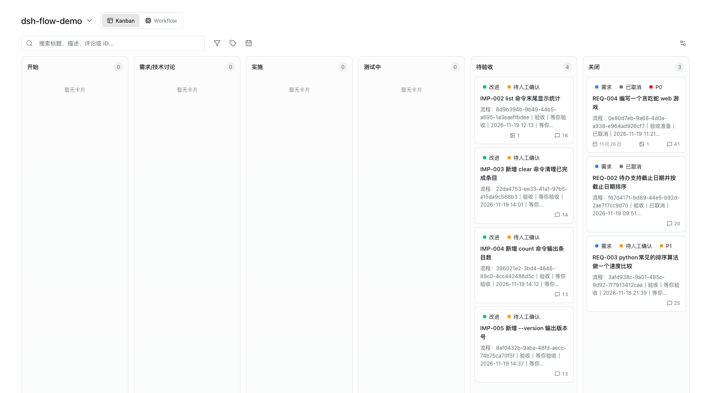
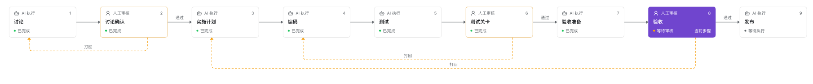
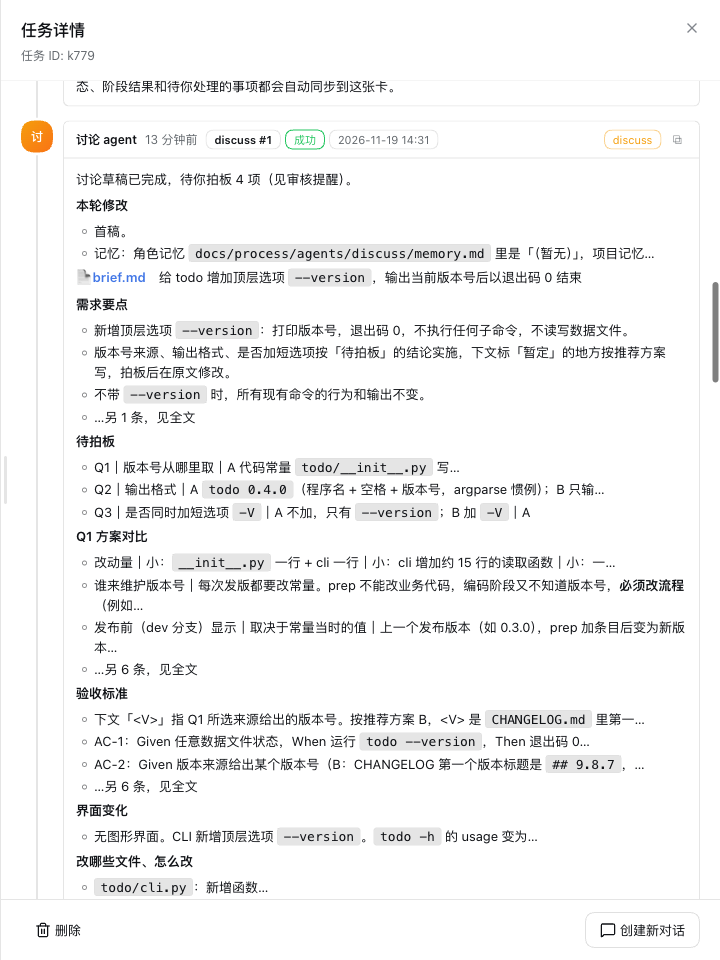
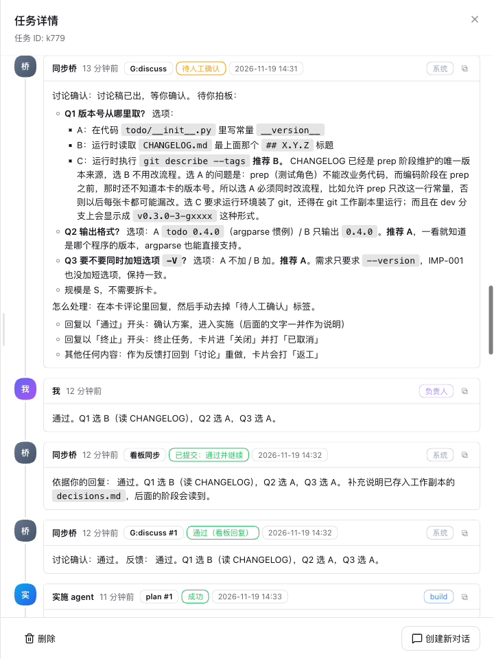
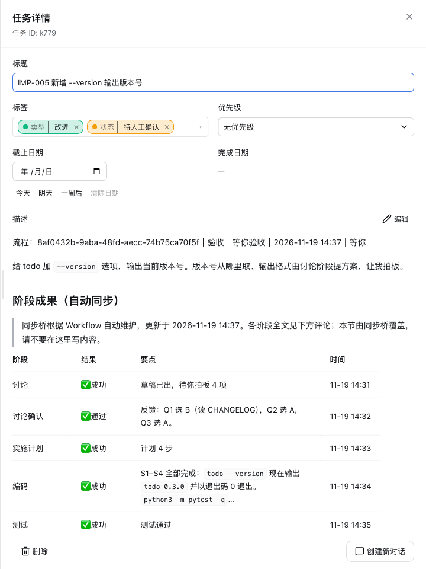
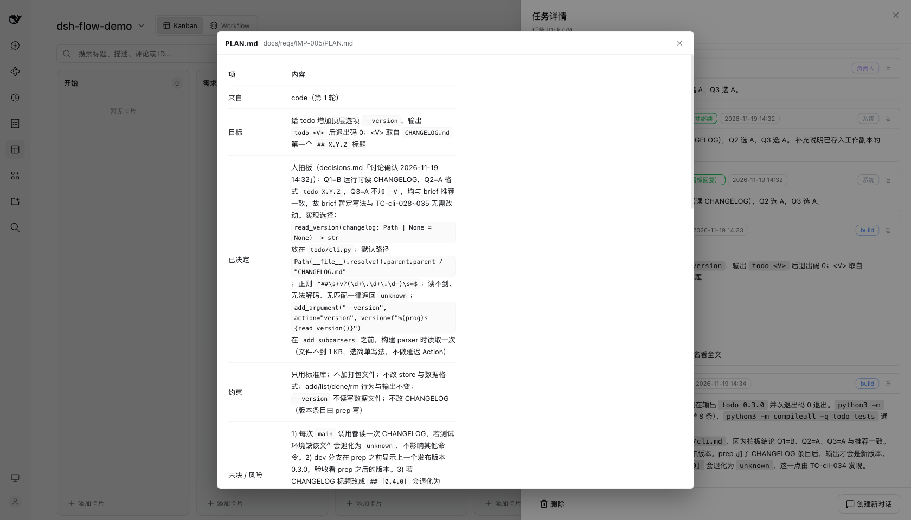

# dsh-kanban-devflow

> **在看板卡片里和 AI 对话，让它走完「讨论 → 计划 → 编码 → 测试 → 验收 → 发布」。你只需要回复和拍板。**
>
> A kanban-driven dev-delivery workflow for DeepSeek Harness (DSH) desktop, built on [@alpacachen/dsh-kanban](https://github.com/alpacachen/dsh-kanban). You talk to role agents through card comments; a bridge keeps the board and the Workflow engine in sync. Docs are in Chinese.



**目录**：👉 [**快速安装**](#安装) ｜ [它是什么](#它是什么) ｜ [流程一览](#流程一览) ｜ [看图了解](#看图了解) ｜ [日常怎么回复](#日常怎么回复) ｜ [功能细节](#功能细节) ｜ [文件目录](#文件目录) ｜ [常见问题](#常见问题) ｜ [安全边界](#安全边界) ｜ [致谢与许可](#致谢与许可)

## 它是什么

这是基于 [@alpacachen/dsh-kanban](https://github.com/alpacachen/dsh-kanban) 插件的**研发流程套件**，自带一份 fork 出来的看板插件 `dsh-kanban-devflow`。一条命令装好插件，之后在 DSH 里打开 git 项目就自动接入。它包含这些东西：

| 组成 | 作用 |
|---|---|
| **项目自动接入** | 打开项目时自动配好流程手册、角色、Workflow、看板甬道和标签、文档骨架 |
| **研发流程** | 一条 9 阶段的「研发交付」Workflow，需求、改进、缺陷、技术债都走它 |
| **四个角色 agent** | 讨论、实施、测试、发布，各有职责定义和记忆。测试只报告缺陷，不改代码 |
| **看板 ⇄ Workflow 同步桥** | 卡片跟着阶段换甬道、打标签、贴评论；你在卡片里的回复变成关卡决定 |
| **看板插件 `dsh-kanban-devflow`** | fork 自 dsh-kanban 1.13.1：多选标签、GitLab 风格评论时间线、评论贴图、产物在卡片里预览、实时保存；`kanban_*` 工具支持 `labels` 参数 |

**适合谁**：在 DSH 桌面版里用 AI 写代码的个人开发者。你想让 AI 按固定流程工作、留下文档和测试记录，自己只在关键节点把关。

## 流程一览



```
讨论 → ◆讨论确认 → 实施计划 → 编码 → 测试 → ◇测试关卡 → 验收准备 → ◆验收 → 发布
                                    ↑_____________|（有缺陷自动打回，最多 5 轮）
```

- **◆ 人工关卡**：卡片带上「待人工确认」标签时就在等你。讨论确认打回到「讨论」，验收打回到「实施计划」。
- **◇ 自动关卡**：同步桥读测试结论，有缺陷就打回编码，连续 5 轮没通过才交给你。
- 其余阶段全自动，你不用盯。

## 看图了解

**每个阶段一条评论，产物精简后直接贴在卡片上**。文档名是链接，点开在卡片里看全文。



**关卡提醒列出「待你拍板」的问题和推荐选项**。你回复「通过」加选择，同步桥确认后流程继续。



<table>
<tr>
<td width="50%"><b>卡片描述末尾自动维护「阶段成果」表</b><br></td>
<td width="50%"><b>点评论里的文档链接，在卡片里预览全文</b><br></td>
</tr>
</table>

## 安装

**前提**：DeepSeek Harness 桌面版 0.2.2-rc.5 或更新版本（在 0.2.2-rc.5 上用过），终端里能运行 `dsh`；电脑上有 Node.js 18+（带 npm）和 git。**不需要**先装看板插件。

**第 1 步：一条命令装好**。先完全退出 DSH，在终端里粘贴运行，然后重新打开 DSH：

```bash
git clone https://github.com/ABK3528/dsh-kanban-devflow.git ~/code/dsh-kanban-devflow && node ~/code/dsh-kanban-devflow/bridge/install.mjs
```

这条命令会：

1. 把套件自带的看板插件 `dsh-kanban-devflow`（`plugin/` 目录，fork 自 `@alpacachen/dsh-kanban` 1.13.1，加了多标签、评论时间线、产物预览、实时保存）打成插件包，放进 `~/.dsh/profiles/desktop/devflow/`，用 `dsh plugin add` 装上。装着原版 `@alpacachen/dsh-kanban`（任何版本）时会换下它：两者的插件 id 相同，只能留一个。插件声明兼容 DSH 0.2.2-rc.5；你的 DSH 是别的版本时，会先为这一对精确版本授权（`dsh plugin allow-version … --accept-risk`，DSH 提示可能崩溃或数据损坏）。改动前先把 profile 的 `package.json`、`pnpm-lock.yaml`、`compatibility.json` 备份到 `~/.dsh/profiles/desktop/workflow-poc/install-backup-<时间>/`。
2. 在 profile 目录写 `dsh-devflow-bridge.json`，登记同步桥 `bridge/kanban-bridge.mjs` 的位置，插件启动时加载它。

需要装插件、更新或授权时，DSH 必须是退出状态，否则命令会提示你先退出。DSH 版本低于 0.2.2-rc.5 时，命令会提示先升级 DSH。插件已经是最新的，命令什么都不改。看板数据存在各项目的 `.dsh-kanban.json` 里（格式和原版相同，版本号仍是 6），装插件、换插件都不会动它。

**第 2 步：打开项目就行**。重新打开 DSH 后，你在 DSH 里打开的每个 **git 项目**都会在几秒内自动接入全套：

| 内容 | 怎么处理 |
|---|---|
| 流程手册 `docs/process/WORKFLOW.md`、四个角色 `docs/process/agents/` | 用套件版本覆盖。项目里原来的版本不同时，先备份到 `<项目>/.dsh/kit-backup/<时间>/` |
| 「研发交付」Workflow | 没有就创建；有但和套件不同就更新（各阶段已选的模型保留） |
| 看板甬道 | 6 个甬道按顺序排在最前，「关闭」设为完成列。其他甬道里没有卡片的删掉，有卡片的保留在最后 |
| 看板标签 | 补齐 11 个「组::名」标签，旧的不分组标签原地改名；不在这 11 个里、也没有卡片在用的标签（插件默认的 New Feature、bug、Feedback 等）删掉，有卡片在用的保留 |
| 文档骨架 `docs/VISION.md`、`ARCHITECTURE.md`、`TEST_STRATEGY.md`、`DEPLOY.md`、`CHANGELOG.md` 等 | 只补缺的，已有的不动 |
| `.gitignore` | 追加 `.dsh/` 和 `.dsh-kanban.json` |

- 接入只写文件，**不提交**。看一眼改动，自己提交即可。骨架里的 TODO（特别是 `DEPLOY.md` 和 `TEST_STRATEGY.md` 的「命令」节）需要你或 AI 补上。
- 每个项目只接入一次。之后只有套件更新（`git pull` 后重启 DSH）时，才会再按上表覆盖一次。
- 不想接入某个项目：在项目根目录建一个空文件 `.dsh-devflow-off`。想全部关掉自动接入：启动 DSH 前设环境变量 `DSH_DEVFLOW_AUTO=0`（已接入的项目照常同步和更新）。
- 不是 git 仓库的目录不会被接入。

**第 3 步：建第一张卡**。在看板「开始」甬道新建一张卡，类型选「需求」，描述写清楚要做什么。卡片出现「待人工确认」后，回复「开始」，再去掉这个标签。之后卡片会自己往前走，到关卡再来找你。

**其他**

- 装完后不要移动或删除 `~/code/dsh-kanban-devflow`，`dsh-devflow-bridge.json` 里记录的是同步桥的路径。
- 更新套件：`git -C ~/code/dsh-kanban-devflow pull && node ~/code/dsh-kanban-devflow/bridge/install.mjs`，然后重启 DSH。
- 换回原版插件：先退出 DSH，运行 `node ~/code/dsh-kanban-devflow/bridge/install.mjs --remove`。它会装回 `@alpacachen/dsh-kanban@1.13.1`、卸掉 `dsh-kanban-devflow`、删掉同步桥登记；看板数据不动，原版只显示每张卡的第一个标签。彻底卸载再运行 `dsh plugin --profile desktop remove @alpacachen/dsh-kanban`。
- 想确认装好没有：`node ~/code/dsh-kanban-devflow/bridge/install.mjs --check`（只读，不改文件；插件、原版残留、同步桥登记三项都正常时退出码为 0）。
- 用的不是默认的 `~/.dsh/profiles/desktop` 时，加环境变量 `DSH_PROFILE_DIR=<profile 目录>`；数据目录不是 `~/.dsh` 时用 `DSH_HOME=<目录>`。

安装出问题，先看下面的「常见问题」。

## 日常怎么回复

在卡片评论里回复，**然后去掉「待人工确认」标签**，同步桥才会执行：

| 回复 | 用在哪里 | 效果 |
|---|---|---|
| `开始` | 「开始」甬道的新卡 | 创建任务并启动 |
| `通过`（可接附言） | 讨论确认、验收、测试关卡 | 放行到下一阶段，附言会交给后续阶段 |
| 其他任何内容 | 同上 | 当作修改意见打回，卡片打「返工」 |
| `重试` | 卡片带「失败」时 | 重跑当前阶段；发布失败时新建只重新发布的任务 |
| `终止` | 任何等待中的卡 | 结束任务，卡片进「关闭」并打「已取消」 |

发布阶段要合并代码、打 tag，需要你到 Workflow 任务详情点开「发布」节点，选「等待审批」→「允许一次」。完整规则见 [WORKFLOW.md](WORKFLOW.md) 第 5 节。

## 功能细节

- **测试独立于实施**：测试 agent 只把缺陷写进 `defects.md`；实施 agent 逐条回应后修复，再测。
- **隔离的工作副本**：每张卡在 `.dsh/workflow-artifacts/<taskId>/repo` 的 `dev/<ID>` 分支上开发，主工作区保持只读，直到发布。
- **标签按「组::名」分组**：类型、状态、原因、标记、结果，同组互斥。看板上只显示短名，悬停显示全名。
- **评论按角色署名**：讨论、实施、测试、发布 agent 和同步桥各有头像和颜色，历史评论同样生效。
- **评论时间线**：相对时间、阶段和结果标签片、复制原文、Markdown 渲染；可以粘贴、拖入或插入图片，点击放大。
- **卡片详情实时保存**：没有「保存」按钮；标签片带 ✕，一点即删。

## 文件目录

| 文件 | 作用 |
|---|---|
| `WORKFLOW.md` | 研发流程手册：通用规则、交接卡、文档地图、关卡和看板约定。接入时复制到项目的 `docs/process/WORKFLOW.md` |
| `agents/` | 四个角色 agent：`discuss`、`build`、`test`、`release`，各含 `AGENT.md`（职责、步骤、输入输出、禁止事项）和 `memory.md`。接入时复制到项目的 `docs/process/agents/` |
| `templates/` | 文档骨架（VISION、ROADMAP、ARCHITECTURE、TEST_STRATEGY、用例库说明、DEPLOY、CHANGELOG），接入时项目里缺哪个补哪个 |
| `workflows.json` | 「研发交付」Workflow 定义（9 个阶段），由 `build-workflows.mjs` 生成 |
| `PROMPTS.md` | 日常使用、审核验收、同步桥说明，以及手动接入的提示词 |
| `bridge/kanban-bridge.mjs` | 看板 ⇄ Workflow 同步桥，运行在 DSH Host 进程内 |
| `bridge/provision.mjs` | 项目自动接入：写文件、创建或更新流程、排甬道 |
| `plugin/` | 看板插件 `dsh-kanban-devflow` 的源码（fork 自 dsh-kanban 1.13.1，MIT），构建产物随仓库提交。改动清单和升级步骤见 [plugin/UPSTREAM.md](plugin/UPSTREAM.md) |
| `bridge/install.mjs` | 打包并安装 `plugin/`、换下原版插件（必要时授权 DSH 版本）、登记同步桥；`--remove` 换回原版 |
| `test/` | `node --test test/`：接入逻辑和同步桥接入流程的测试，不碰真实 DSH |
| `docs/design/stage-agents.md` | 设计文档：角色 agent、测试独立、评论精简等的设计与取舍 |
| `docs/images/` | README 截图 |

## 常见问题

**看板插件报错或不见了（之前装的是原版 dsh-kanban 或旧版套件）**

旧版套件靠给原版 `@alpacachen/dsh-kanban` 打补丁工作，现在改成安装自带的插件 `dsh-kanban-devflow`。完全退出 DSH，运行下面这条，再重新打开 DSH：

```bash
git -C ~/code/dsh-kanban-devflow pull && node ~/code/dsh-kanban-devflow/bridge/install.mjs
```

`install.mjs` 会装上 `dsh-kanban-devflow` 并换下原版插件（旧补丁随原版一起移除）。改动前会备份 profile 的 `package.json`、`pnpm-lock.yaml`、`compatibility.json`；看板数据不受影响。

**升级 DSH 后看板插件不见了**

DSH 只加载声明兼容当前版本的插件。授权是按「插件版本 + DSH 版本」精确记录的，DSH 升级到插件没声明的版本后都要重新授权：退出 DSH，重跑一次 `install.mjs`，它会发现新版本没授权并补上（也可以手动运行下面这条，版本号以 `plugin/package.json` 为准）。

```bash
dsh plugin --profile desktop allow-version dsh-kanban-devflow@1.13.1-devflow.1 --dsh-version <你的 DSH 版本> --accept-risk
```

DSH 提示这可能导致崩溃或数据损坏，介意的话先备份 `~/.dsh`。

**项目被自动接入后想撤回**

接入不会提交。用 `git status` 看改动，`git checkout`/删除不想要的文件即可；被覆盖的旧版流程手册和角色定义在 `<项目>/.dsh/kit-backup/<时间>/`。再建一个空文件 `.dsh-devflow-off`，以后就不会再接入。看板和 Workflow 的改动要在 DSH 界面里手动改回。

**我改过项目里的 WORKFLOW.md 或角色定义**

套件更新后第一次同步会覆盖它们，旧版备份在 `<项目>/.dsh/kit-backup/<时间>/`。想长期保留自己的改法，改套件仓库里的 `WORKFLOW.md` 和 `agents/`（会同步到所有项目），或者给这个项目建 `.dsh-devflow-off`。

**改了代码不生效**

改 `bridge/kanban-bridge.mjs` 要重启 DSH。改 `plugin/` 要先在 `plugin/` 里构建（`pnpm install && node build.mjs`），再退出 DSH 重跑 `install.mjs`：插件包文件名带内容哈希，内容变了才会重装。不确定装没装好，用 `install.mjs --check` 看。

## 安全边界

- 只有人在看板界面上操作（`activity.source === 'human'`）才会触发决定；AI 用 `kanban_*` 工具改标签不算。
- 唯一的例外是测试关卡：同步桥按测试结论自动通过或打回编码，决定记为 `bridge-auto`。它不会放行未通过的测试；连续 5 轮未通过、结论认不出来或测试阻塞时，一律交给你。
- 发布阶段要写主工作区，需要你在 Workflow 节点弹窗里点「允许一次」，同步桥不能代点。
- 同步桥只自动接入 git 项目，跳过有 `.dsh-devflow-off` 的项目；只处理「研发交付」流程的任务。
- 接入时覆盖文件前先备份，不提交，不删除有卡片的甬道，不动卡片。

## 致谢与许可

- 看板插件 `plugin/` fork 自 [alpacachen/dsh-kanban](https://github.com/alpacachen/dsh-kanban) 1.13.1（MIT），保留原许可和版权声明（[plugin/LICENSE](plugin/LICENSE)），改动见 [plugin/UPSTREAM.md](plugin/UPSTREAM.md)。
- 本项目以 [MIT](LICENSE) 许可发布。与 DeepSeek 和 dsh-kanban 作者无关，不是官方项目。
